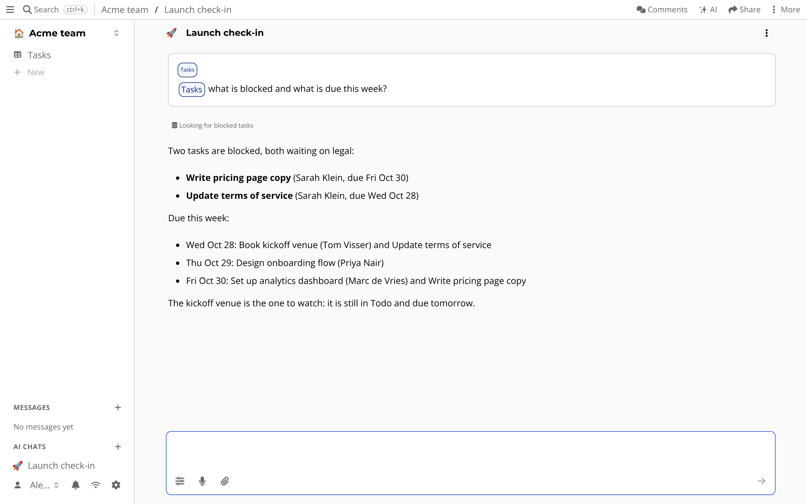

# AI chat

Chat assistants know nothing about your work, until you paste it in.
And pasting it means handing your notes to someone else's product.

AI chat in atomic.place can see the resources you point it to, uses the model *you* choose, and stays out of the way when you switch it off in the settings.



You can connect two providers:

- **OpenRouter**: a cloud API with many commercial and open models.
- **Ollama**: models running on your own hardware, for privacy and offline use.

## Configuring AI

You need to connect a model first: the chat shows *Set up a model* until you do.

Go to the settings page and find the AI settings.

**OpenRouter**: press *Login with OpenRouter*, or paste an API key.
You need an OpenRouter account with credits.

**Ollama**: [install Ollama](https://ollama.ai/download), pull a model with `ollama pull <model-name>` and start it with `ollama serve`.
Under *AI Providers* choose Ollama and enter its URL (`http://localhost:11434/api` if it runs on your machine).
Then open an AI chat, click the agent in the chat input, press edit and select the model.

## Using it

The fastest way is the AI sidebar, with the ✨ button in the top right.
These chats are not saved.
Press the save button to turn one into a resource, which you can share like any other.

For a full page chat that is kept, press *+* and choose *AI chat*.

Type `@` and the name of a resource to add it to the conversation as context.
This also works for resources of connected MCP servers.


## Agents

An agent has a system prompt, a model and a list of tools.
By default there is the *Atomic Assistant*, which can answer questions about your data and search and edit resources, and a general agent without instructions.
Click the agent in the chat input to edit them, create your own, or choose a default.
With *Automatic agent selection* on, the best agent is picked from the names, descriptions and tools you gave them, so write good ones.


## MCP servers

Add [MCP](https://modelcontextprotocol.io/) servers in the settings under *MCP Servers*.
Then edit an agent and tick the servers whose tools it may use.
Type `@` to reference the resources an MCP server offers.


The browser cannot do stdio, so stdio-only servers need a bridge such as [Supergateway](https://github.com/supercorp-ai/supergateway):

```bash
npx -y supergateway \
    --stdio "<MCP_SERVER_COMMAND>" \
    --outputTransport streamableHttp --stateful \
    --sessionTimeout 60000 --port <PORT>
```

## What is special about it

Your chats are resources, so they sync, can be shared and carry your permissions.
The assistant edits your data through the same signed commits you would, so changes show up in the history.
