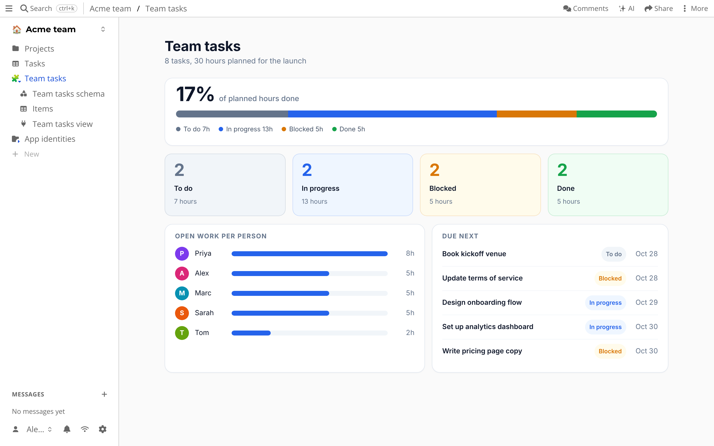

# Apps

A workspace never has exactly the screens you need.
A habit tracker, a recipe box, a timesheet: too small for a product, too useful to go without.

An *app* is a small piece of software that runs inside your drive, in its own frame, and keeps its data in a table of its own.
Because that data is a normal table, you can still sort it, link to it and share it.

## Getting started

Offline there is no catalog to browse.
Press *New app* to create an app, and it opens in its own frame.
Where a catalog is available, you can also install apps from it, and you see what an app asks for before it is saved.

The app in the picture is a dashboard over the *Tasks* table: progress bar, counts per status, work per person and what is due next.
It is one JavaScript file that reads the rows of the table and draws them.
It only reads, so the table and the dashboard cannot disagree.
Ask the [AI chat](ai-chat.md) to build one, or write the file yourself.

An app can also add a view to a table, next to Kanban and Calendar.
It is then one more way to look at rows you already have.

## What is special about it

- **Apps only get what you approve.** They are installed with grants, and can be paused or removed at any time.
- **Your data stays yours.** An app writes to your drive, not to the server of its author.
- **You can build your own** in plain JavaScript (a module that exports a `view` function and draws into the frame), or extend the server with WebAssembly [plugins](../plugins.md). See [custom views](../plugins/custom-views.md).
