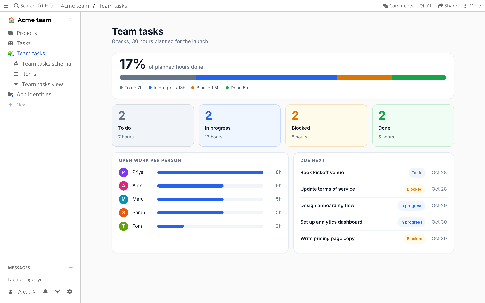

# Apps

A workspace never has exactly the screens you need.
A habit tracker, a recipe box, a timesheet: too small for a product, too useful to go without.

An *app* is a small piece of software that runs inside your drive, in its own frame, and keeps its data in a table of its own.
Because that data is a normal table, you can still sort it, link to it and share it.

## Getting started

Offline there is no catalog to browse.
Press *New app* to create an app, and it opens in its own frame.
Where a catalog is available, you can also install apps from it, and you see what an app asks for before it is saved.

The app in the picture is a dashboard over the *Tasks* table: progress bar, counts per status, work per person and what is due next.
It is one JavaScript file that reads the rows of the table and draws them.
It only reads, so the table and the dashboard cannot disagree.
Ask the [AI chat](ai-chat.md) to build one, or write the file yourself.

An app can also add a view to a table, next to Kanban and Calendar.
It is then one more way to look at rows you already have.

## Import GitHub issues

From My Drive, open the account menu and choose **Apps**. Turn on **Show
experimental plugins** to see services from your configured integration proxy.
Choose **Add to Drive** on GitHub to open its account chooser. Connect an account,
then open its entry to install a principal App such as **GitHub · michiel**.
**Public** installs a separate **GitHub · Public** App without signing in. The
chooser stays in Apps; it does not add a provider folder to your drive.

Each drive has one App for each configured proxy, provider and typed principal.
The identity comes from the catalog's Authenticated Principal declaration, not a
display name. Reconnecting the same account opens its existing App, including
after you rename or move it within the drive. Its provider icon is saved in the
drive, and reopening preserves an icon you chose yourself. Apps also lists your
installed principal Apps so you can open them directly.

Apps and sync are scoped to their drive. Connecting the same account in another
drive creates a separate App with separate collections, rows and saved filters.
Having both drives open or cached does not combine their data. Sync checks the
server for existing resources before creating new ones; cached collections stay
browsable when the server is unavailable. Conflicting pending writes are retained
and reported rather than retried indefinitely.

Each App has one table per catalog resource type, such as **Organizations**,
**Repositories** and **Issues and pull requests**. Navigation stays at
Drive → principal App → item type. An organization and a repository are rows,
rather than folders containing another copy of each table.

Choose a saved **Filter** to browse the rows observed through a particular
catalog source. **All cached rows** shows the shared table across its filters.
For example, sync Organizations, then choose **Open** on an organization. This
opens the account's Repositories table with a saved organization filter. Open a
repository to reach the same account's Issues table with that organization and
repository scope retained. Related collection buttons can follow the selected
filter across all its rows. Filters can be renamed and bookmarked.

An imported record's own page also offers its stored relationship actions.
For example, an organization can open its Repositories filter and an Issues
filter through those repositories, when both relationships are declared in the
catalog. These actions reuse existing filters and perform no provider request.
A new filter has no completed sync history or observed membership yet; use its
Sync controls to import that scope, or choose **All cached rows** for data from
other filters and earlier imports. Its empty result does not delete those rows.

Use **Sync settings** for the selected filter, then **Sync now**. Each filter has
its own sync state and **Pause**/**Resume** controls. Pausing one filter retains
its rows and does not pause another. Runs continue while you browse other views
or resources in the app; closing the app stops them. Paused status survives a
reload. The Sync view also offers source setup for new saved filters; catalog
inputs and relationships determine the available sources.
Sync history describes the selected filter, rather than every row in its table.
The entry count shown in Sync belongs to its last read attempt. Existing rows
alone do not imply that this particular filter has completed a successful read.

To link a public repository, open **GitHub · Public**. In its Sync view,
select the Issues collection and the catalog's repository source, enter its
owner/name, give the filter a name and choose **Save filter**. The source resolves
to the repository's canonical identity. This branch uses GitHub's public API
without a GitHub account. GitHub's Issues endpoint includes pull requests.

**Table** follows the schema derived from the API description and provides
**Open** for catalog-declared collection navigation. Item tables use Table and
Sync. The old unconfigured Collection tab is hidden, and opening the item
table uses the ordinary Table settings. Existing Collection links open native
Table with their saved settings and filter intact. Renamed or customized views
are retained, and the principal App keeps its collection list.
Opening, filtering or returning to these views makes no provider request.
They remain available during a sync or a provider outage. Overlapping saved
filters share one canonical row. Complete reads replace membership only for their
own filter; partial or interrupted reads retain prior membership and accepted
rows. Missing fields do not erase richer stored values. User fields are retained.
Moving a row within the same drive retains its identity; rows moved outside the
worker's collection are protected from refresh rather than duplicated.
Renaming a column changes its display label, while sync continues to address its
stable property identity. Editing a provider-managed cell value can be replaced
by a later provider observation; user-defined fields remain separate.

A read is bounded to 128 requests, 4,000 records and five minutes, including
validation and storage of supplied linked records. Reaching a limit keeps the
accepted data and marks the result incomplete; narrow the saved filter to finish
a smaller read.

Catalog-declared foreign keys appear as links to Atomic resources. When an API
supplies an embedded record, its known fields seed the linked resource in the
same import without another provider request. For example, repository owners
and issue authors link to stored organizations or users. Undeclared objects stay
JSON. Raw API values and read evidence are retained. Omitted fields preserve
stored data; an explicitly unresolved relationship clears its previous managed
link and keeps a diagnostic rather than displaying a stale destination.
A relationship sync keeps its selected source record unchanged while reading
its targets. Returned copies link back to that record; other linked records can
still be enriched. An outside change to the selected source cancels the run.

Identity-only and incomplete linked records remain summaries until enough
required data is supplied. Embedded records can offer catalog-declared relationship
actions without claiming an originating collection read. Older stored summaries
use their saved relationship definitions; Sync checks the current catalog and
required bindings before making a provider request. A summary missing those fields
cannot start that read. Later imports enrich the same resource, retaining its
identity and user fields. These references stay within the selected drive,
provider and principal. A retained identity in Trash blocks replacement; restore
it explicitly to resume syncing. Opening a view does not restore trashed data.

The canonical catalog identifier is now `github`. Installations and other clients
using the historical `github-issues` identifier need reinstalling or reconnecting.
Stored Atomic resources are retained; the rename does not automatically remove
them. Historical GitHub-specific view links remain readable; canonical item tables
render through native Table.

Migration promotes an existing principal resource in place, preserving its
collections, row identities, saved filters and user fields. Verified account
identity preserves the same App across connection changes. It never matches accounts by
display name. Conflicting saved entries are reported for review with their data
retained. An expired connection offers recovery controls while cached collections
remain available.

Your integration proxy must support client-held connection keys and have
GitHub OAuth configured. The
[IAP catalog](https://github.com/ontola/atomic-plugins/blob/main/overlays/catalog/2026-11-20-reference-links.json)
provides authenticated identity, collection schemas, public access and relationship
navigation through CRUD references and standard OpenAPI response Links. Other
providers can use the same runtime when their catalog supplies those definitions.

## What is special about it

- **Apps only get what you approve.** They are installed with grants, and can be paused or removed at any time.
- **Your data stays yours.** An app writes to your drive, not to the server of its author.
- **You can build your own** in plain JavaScript (a module that exports a `view` function and draws into the frame), or extend the server with WebAssembly [plugins](../plugins.md). See [custom views](../plugins/custom-views.md).
