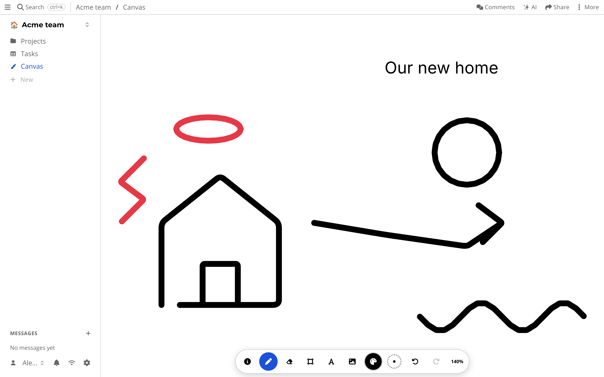

# Canvas

Some ideas do not fit in a document or a table.
You want to sketch, point and draw next to someone.

A canvas is an infinite surface you draw on together.

## Getting started

Press *+* and choose *Canvas*.
Draw with the pen, pick colors from the color fan, and pan and zoom around.
Use *Canvas help* to see all controls, for mouse, touch and pen.

You can scrub back through the history to see how the drawing came to be.

## What is special about it

Strokes sync live, so other people see them as you draw.
It works offline, and the drawing is yours.
There is also a [Flutter version](../flutter.md) of the canvas for phones and tablets, which syncs with the same drive.
