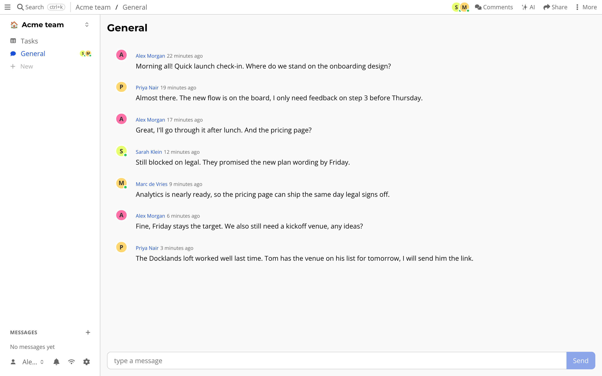

# Chat and messages

Email is slow and a big chat tool is a place you have to live in.
Often you just need a room for a team, or a private line to one person.

## Group chat

Press *+* and choose *Chat room*.
A chat room is a channel in your drive.
People who can read the room can write in it, with attachments, replies and search.
Type `@` to mention someone.

## Messages to a person

Use *New message* and enter someone's Atomic ID, or pick *Message* from their avatar.
This starts a conversation that is *end-to-end encrypted*.
Only the people in it can read what you write.
Not the server, and not the people who run it.

## Inbox

Messages, comments and replies meant for you collect in your *Inbox*.
Meetings that are live show up in a banner.

## What is special about it

Chat is stored and synced like everything else, so you can read it offline and it keeps your history.
Messages are signed by the person who wrote them.
Because a chat room is a resource, you can link to it, or open it from a meeting or a task.
