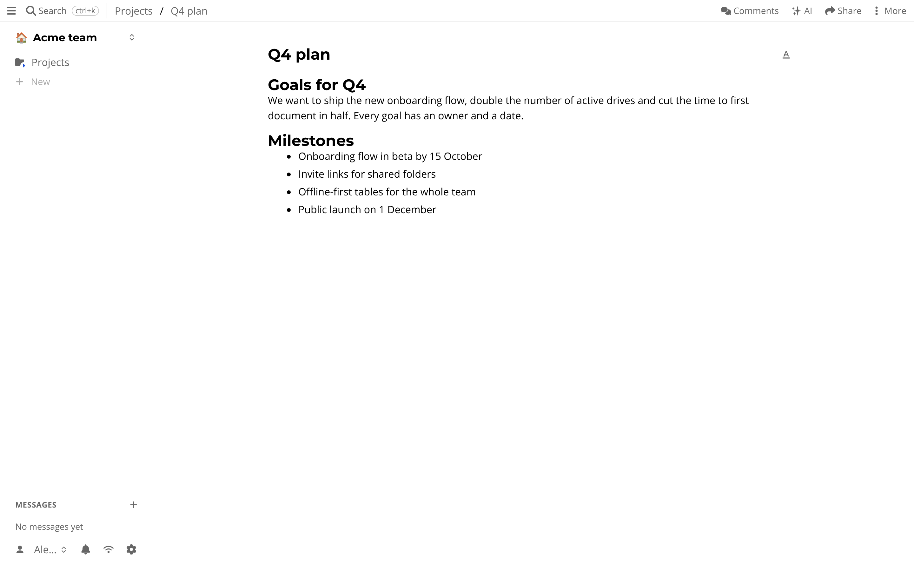

# Documents

You write something, and then someone else needs to add to it.
Emailing a file back and forth makes two versions.
A shared document should be *one* document.

In atomic.place, a document is rich text that everyone with access can edit at the same time.
You see other people's cursors while they type.

## Getting started

Press *+* in the sidebar (or on a folder) and choose *Document*.
Type a title, then start writing.
Headings, lists, code blocks, images and links are in the toolbar or available with the usual markdown shortcuts.

To discuss a part of a document, use the comments panel next to it.
Everything also shows up in the *Inbox* of the people involved.

## What is special about it

- **It works offline.** Edits are stored on your device first and merge when you are back online. Two people typing in the same paragraph while offline do not overwrite each other, because the text is a [CRDT](../sync-engine.md).
- **Every edit is signed.** The history page shows who changed what and when, and you can step back through every version.
- **It is your data.** A document is a [resource](../core/concepts.md) with a URL. You can link to it from a table row, a chat message or a meeting, and it keeps the same permissions as the folder it lives in.
