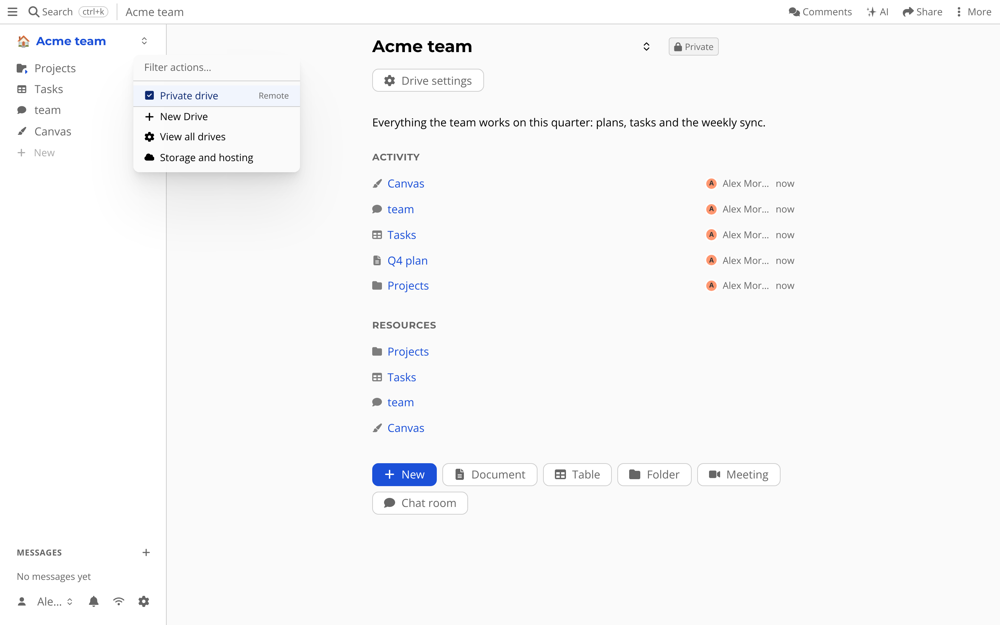

# Folders and drives

Everything you make needs a place to live, and a way to decide who can touch it.

## Drives

A *drive* is the top of a tree of resources, and the unit you sync and share.
You get a home drive when you start.
The drive switcher at the top of the sidebar lists *Private drive*, *New Drive* (for a team or project), *View all drives* and *Storage and hosting*.
Drive settings let you manage who has access, and what is installed.

When you create a workspace through an Atomic account, Cloud Vault starts its first backup in the background.
You can keep working while the app shows that the first backup is pending. If it fails, use *Retry backup*.
*Storage and hosting* shows when the last backup succeeded.
Atomic shows a warning when it can’t verify a copy of the drive in Cloud Vault or on an external server, or when it can’t verify a backup from the last seven days.
A verified backup older than 24 hours shows a lower-priority warning until it reaches seven days.
The app can verify that a server holds drive data, while backup dates come from Cloud Vault. Sync with another browser and the server built into the desktop app do not count as external copies.
Use *Back up now* in Sync settings to make a fresh Cloud Vault backup, including when an unchanged drive has an older backup.

## Folders

Press *+* and choose *Folder*.
Folders hold documents, tables, chat rooms, other folders and files.
You can show a folder as a *List View* or a *Grid View*.
Drag things in the sidebar to move them, or use the move option in a resource's menu.

## What is special about it

Rights flow down the tree.
If you can edit a folder, you can edit what is in it, unless something below says otherwise.
Read more in [drives and permissions](../hierarchy.md).
Because a drive is just a tree of resources, you can back it up, move it to another server, or fetch it through the [API](../atomicserver/API.md).
