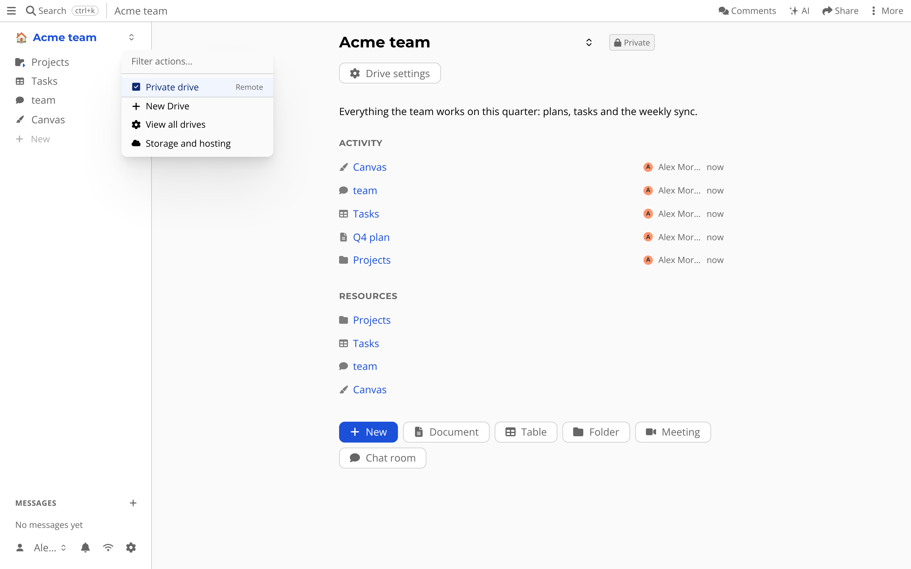

# Folders and drives

Everything you make needs a place to live, and a way to decide who can touch it.

## Drives

A *drive* is the top of a tree of resources, and the unit you sync and share.
You get a home drive when you start.
The drive switcher at the top of the sidebar lists *Private drive*, *New Drive* (for a team or project), *View all drives* and *Storage and hosting*.
Drive settings let you manage who has access, and what is installed.

## Folders

Press *+* and choose *Folder*.
Folders hold documents, tables, chat rooms, other folders and files.
You can show a folder as a *List View* or a *Grid View*.
Drag things in the sidebar to move them, or use the move option in a resource's menu.

## Cloud Vault backup

Cloud Vault backs up a drive to the cloud so you can restore it on a new device.
Your documents, tables and other resources are encrypted on your device first, so only you can read them.

Files (uploads, images, attachments) are included, but they are handled differently.
Each file is stored once, under a hash of its contents, and shared by every backup that holds the same file.
That means files are **not end-to-end encrypted**: the service operator can read them, and can tell whether a backup holds a file it already knows.
Every backup counts the full size of each of its files toward its own storage, even when another backup stored the same file first.
When you delete a file, its bytes are removed from the cloud once no backup refers to it any more, after a short window in which a deletion can still be undone.

If a file is not on the device that runs the backup, it cannot be backed up from there.
A restore says how many files it could not bring back.
A backup file downloaded from Cloud Vault contains the encrypted history only, not the files.

## What is special about it

Rights flow down the tree.
If you can edit a folder, you can edit what is in it, unless something below says otherwise.
Read more in [drives and permissions](../hierarchy.md).
Because a drive is just a tree of resources, you can back it up, move it to another server, or fetch it through the [API](../atomicserver/API.md).
