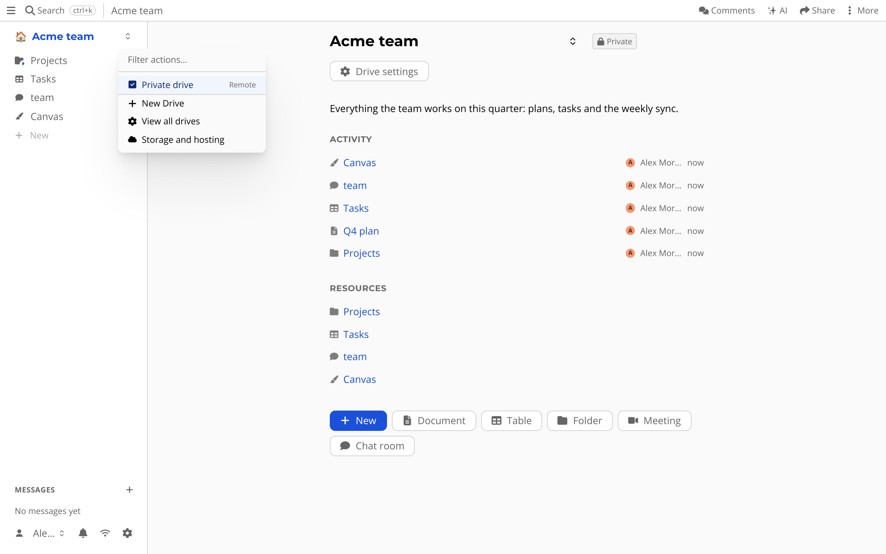

# Folders and drives

Everything you make needs a place to live, and a way to decide who can touch it.

## Drives

A *drive* is the top of a tree of resources, and the unit you sync and share.
You get a home drive when you start.
The drive switcher at the top of the sidebar lists *Private drive*, *New Drive* (for a team or project), *View all drives* and *Storage and hosting*.
Drive settings let you manage who has access, and what is installed.

## Folders

Press *+* and choose *Folder*.
Folders hold documents, tables, chat rooms, other folders and files.
You can show a folder as a *List View* or a *Grid View*.
Drag things in the sidebar to move them, or use the move option in a resource's menu.

## What is special about it

Rights flow down the tree.
If you can edit a folder, you can edit what is in it, unless something below says otherwise.
Read more in [drives and permissions](../hierarchy.md).
Because a drive is just a tree of resources, you can back it up, move it to another server, or fetch it through the [API](../atomicserver/API.md).
