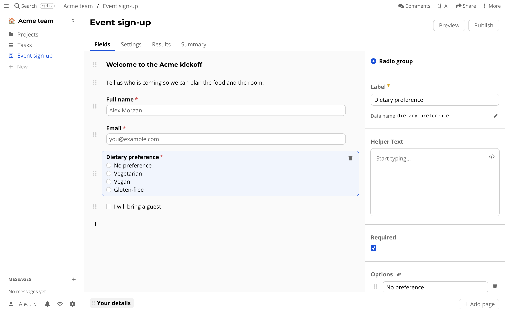
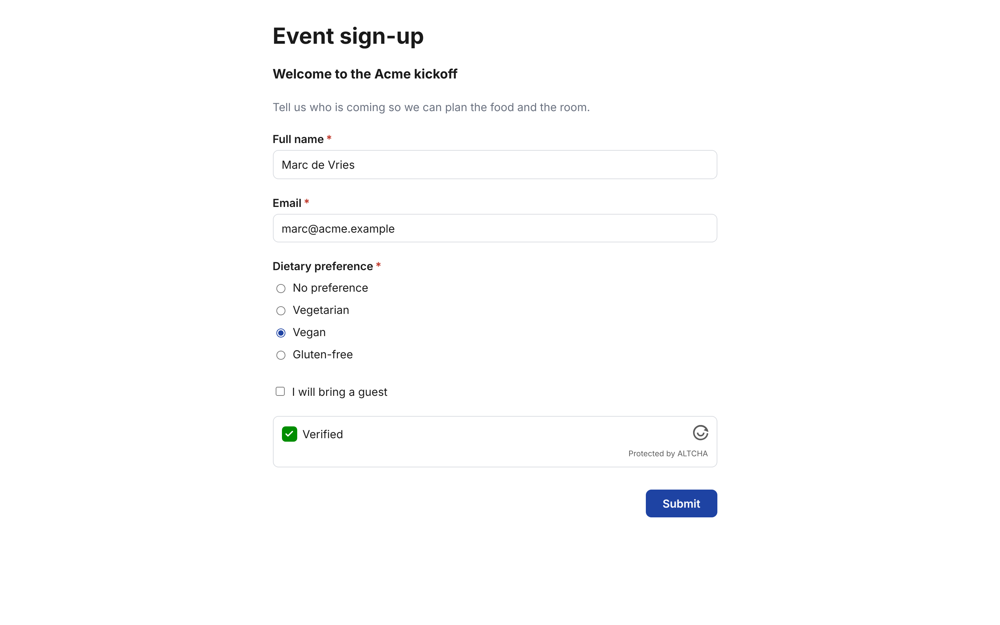

# Forms

You want answers from people who are not in your drive: sign-ups, feedback, applications.
A group chat gets lost, and a shared spreadsheet gives every respondent a view of everyone else's answers.

A *form* in atomic.place is a page that anyone with a link can fill in, without an account.
Their answers arrive as rows in a table in your drive.

## Getting started

Press *+* and choose *Form*, then give it a name.
The form gets a table of its own for the answers, and a class that describes one answer.
You can also open the menu of an existing table and choose *Create form from this table*, then pick which columns to ask.

The builder has four tabs: *Fields*, *Settings*, *Results* and *Summary*.
In *Fields* you add questions (short and long text, email, number, date, checkbox, radio, dropdown, multi-select, rating and more), headings and info boxes, spread over one or more pages.
You can mark a question as required, set a default choice, and show a page only when an earlier answer matches.
*Settings* has colors, rounding, an image, the progress bar and *Form access*.

## Sharing it

Press *Publish*, then *Share* to copy the link, show a QR code or copy an embed snippet.
Under *Form access* you choose *Anyone with the link* or *Invite only*, where each invite link works for exactly one submission, and you can set opening and closing dates.

## Where the answers go

Every answer is a row in the results table, so you can sort, filter, link and export it like any other [table](tables.md).
*Results* shows that table inside the builder, and *Summary* counts answers per choice and draws the numbers as bars.

## What is special about it

- **Respondents need no account.** The server writes the row on their behalf, and only into a table in the same drive.
- **You can build offline.** Creating and editing a form works without a connection, but publishing and receiving answers needs a server to host the link.
- **Half-filled answers stay with the respondent.** They are kept in their browser so they can resume, unless you turn that off.

See [Forms in the schema](../schema/forms.md) for the data model.
