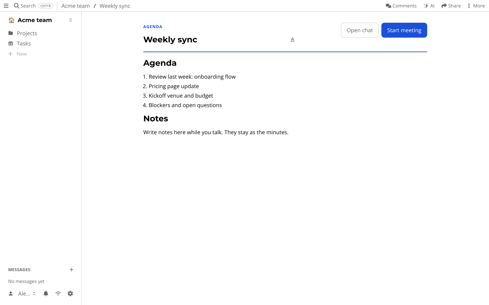

# Meetings

Meeting notes usually live in one tool, the call in another and the chat in a third.
Afterwards nobody can find what was decided.

A meeting in atomic.place is one resource that holds the *agenda*, the *notes* and the *minutes*, plus the chat that happened around it.

## Getting started

Press *+* and choose *Meeting*.
A new meeting shows *Open chat* and *Start meeting*, with an *Agenda* and a *Notes* section below.
Write the agenda before anyone joins.
Share the meeting like any other resource (see [sharing](sharing.md)).

When it is time, press *Start meeting*.
The meeting shows up as live for everyone in the drive.
Attendees can join and follow the person leading it, so they see the same page.
Write notes while you talk, under "Write notes here while you talk. They stay as the minutes."
Press *End meeting* when you are done, and what you wrote stays as the minutes.

*Open chat* shows the chat of the meeting, before, during and after.
Once the meeting has started, you can use its call controls if you want your voice in the room.

## What is special about it

- **Nothing to schedule elsewhere.** The agenda, notes, chat and decisions are one resource with one set of permissions.
- **It outlives the call.** You can reopen an ended meeting and read the notes and chat later, or link to it from a task.
- **The notes are a document.** They are edited live by everyone, work offline and have full history (see [documents](documents.md)).
