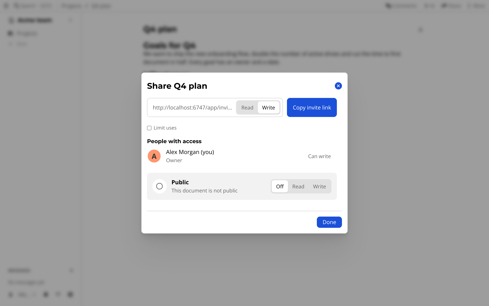

# Sharing

Sharing usually means making an account for someone, and then arguing over who sees what.

In atomic.place you share with a link.
The link is an *invite* that gives the person you send it to a role on a drive, or on a single folder or resource.

## Getting started

Open the resource or folder and press *Share*.
The first time, it asks for your profile name ("How your colleagues see you").
In the dialog, set the toggle to *Read* or *Write*, and press *Copy invite link*.
Use *Limit uses* if the link should only work a few times.
The *Public* row (*Off*, *Read* or *Write*) controls whether anyone with the address can open it.
The *People with access* list shows who has a role now.
Whoever opens it is asked to sign in or create an identity, and then lands on the shared item.
You can share a drive between browsers directly: the person who invited you keeps their tab open while you join.

## What is special about it

There are no accounts to create for guests, because identity is a [key](../agents.md) and not a login on your server.
Access follows the tree, so sharing a folder shares what is in it.
Read [invitations and sharing](../invitations.md) for how links and rights work underneath.
