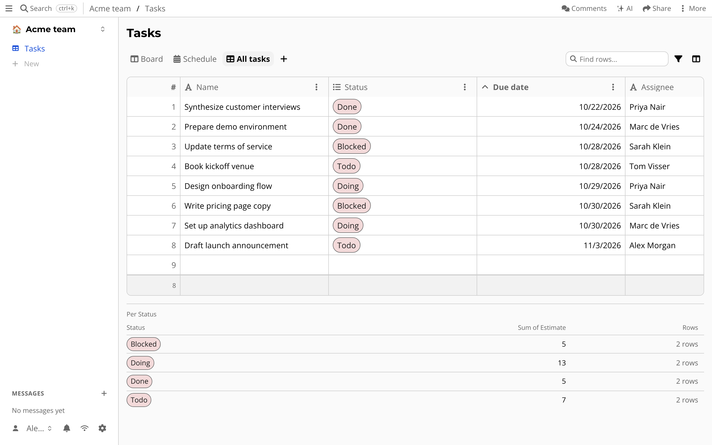
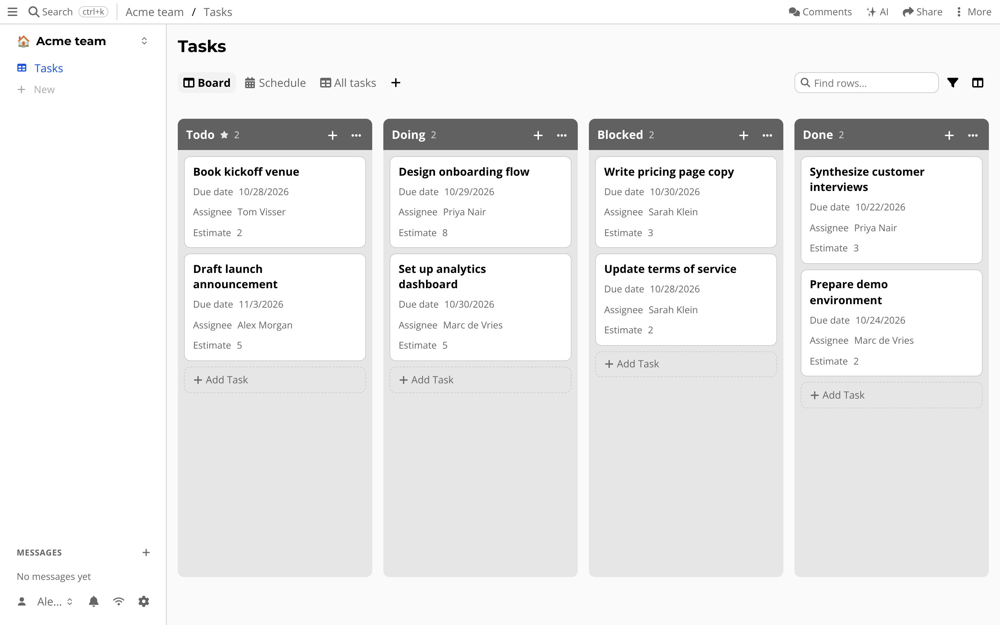

# Tables

A spreadsheet lets you type anything in any cell.
That is fast, until one cell says "tomorrow" in a column of dates.

A table in atomic.place has *types*.
Each column has a datatype, so a number column cannot contain text.
Every row is a resource of its own, so you can link to it, comment on it and share it.

## Getting started

Press *+* and choose *Table*.
Give it a name, and optionally pick a template in the *Start from* list (an issue tracker, project tasks, a time tracker, expenses, a CRM and more).
The name becomes the title of the table and the name of the class its rows belong to.
A template creates views named after it, for example *Board*, *Schedule* and *All tasks* for *Project tasks*.
You can also base the table on a class that already exists.

Classes and columns created this way are added to the default ontology of the drive, so you can use them elsewhere.

## Working in a table

- **Rearrange and resize** columns by dragging.
- **Sort** by clicking a column header, and an arrow shows the sort order.
- **Filter** with the filter button, or search with *Find rows…*.
- **Summaries** per group, such as *Per Status*, show below the table.
- **Navigate with the keyboard**, like in a spreadsheet.
- **Copy and paste** many cells at once, also between tables and from other spreadsheet apps.
- **Export to CSV** with the export button.
- **Derived columns** compute a value from other columns with a formula, and the totals footer can sum or average them.

## Views

The same rows can be shown in different ways.
Use the *+* tab next to the table tab (*Add a view*) to add one, next to the default *Table*:

- **Kanban**: cards grouped by a select column, such as *Status*. Drag a card to change it.
- **Calendar**: rows placed on a date column, including repeating events.
- **Timer**: start and stop a clock per row, for tracking time.
- **Dashboard**: numbers, charts and buttons computed from the table.
- **Issues**: a list with status, made for trackers.

A view only changes how rows are shown.
Deleting a view never deletes rows.
An [app](apps.md) can also add a view to a table.

## What is special about it

The data is stored on your device, so the table is fast and works offline.
Rows, columns and views are all part of your drive, and sync like everything else.
