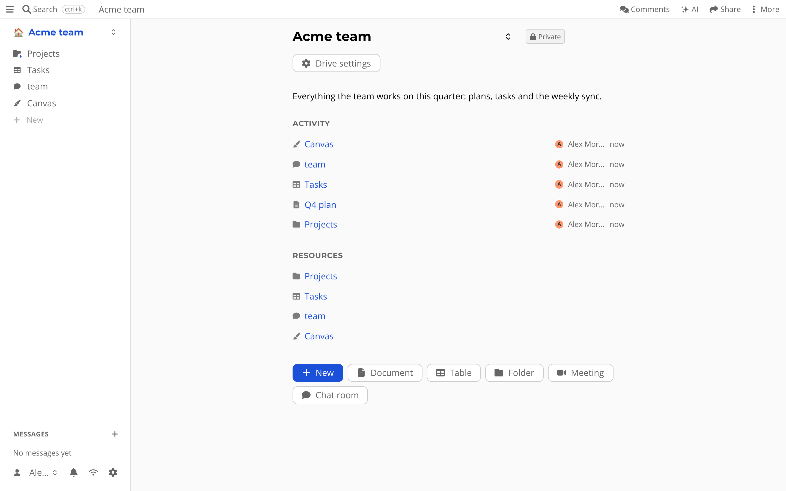

{{#title Using atomic.place}}
# Using atomic.place

Most workspace apps keep your documents, tables and chats on a server that someone else runs.
If that server is down, you are down.
If the company changes its mind, your data goes with it.

atomic.place is an all-in-one workspace where *your data lives in your own [personal data store](personal-data-store.md)*.
It sits on your device, every change is signed with your key, and it [syncs](sync.md) to other devices and people.
The same app also runs in a browser, on a desktop and on a server you own.

## Three ways to run it

It is one app.
What differs is where your data is kept safe when your device is off.

### In your browser, at atomic.place

Open [atomic.place](https://atomic.place) and sign up.
You get a drive of your own that is hosted for you, so it stays reachable and your collaborators can open it while you are offline.
Nothing to install, nothing to maintain.
The data is still stored on your device first, in the browser, and your key never leaves it.

### The desktop app

The desktop app is the same workspace in its own window.
It has a small AtomicServer built in, bound to `127.0.0.1`, so the app works without any account or network.
Your devices find each other and sync directly.
On desktop it can also mount a drive as a folder in Finder or your file manager (the virtual drive).

You can get it from the [GitHub releases](https://github.com/ontola/atomic-server/releases): a `.dmg` for macOS, an `.exe` installer for Windows and an AppImage, `.deb` or `.rpm` for Linux.
It is still a beta, so expect rough edges.
Because the built-in server uses the same data directory as the `atomic-server` command, you cannot run both at once.

### On your own server

AtomicServer is a single binary (or Docker image) that stores your data, serves the web app, handles search and syncs your devices.
Run it on a laptop, a Raspberry Pi or a VPS, open its address in a browser, and you have the same workspace under your own domain.
See [installation](installation.md) to start it, and [self-hosting](../atomic-server.md) for what it does for you.

On first start, open `/setup` on your server to claim it as the admin.
The invite creates an [agent](../agents.md) (your identity) in your browser.
Save the secret it shows you in a password manager.
It is the only way back into your account, and nobody can recover it for you.

## Which one should I pick?

| | Hosted | Desktop | Your own server |
| --- | --- | --- | --- |
| Install anything | No | Yes | Yes |
| Works offline | Yes | Yes | Yes |
| Reachable while your devices are off | Yes | No | Yes |
| Someone else runs it | Yes | No | No |

You do not have to choose forever.
Your identity is a key, not an account on a server, so you can move a drive between these options without changing who you are.

## What is in it

Create things with the *+* button in the sidebar, or the quick buttons next to it.

- [Documents](../app/documents.md): rich text that several people can edit at once.
- [Tables](../app/tables.md): typed rows, with Kanban, calendar, timer, dashboard and issues views.
- [Meetings](../app/meetings.md): an agenda, notes and minutes in one place, with a chat and an optional video call.
- [Chat and messages](../app/chat.md): group chat rooms and private end-to-end encrypted conversations.
- [AI chat](../app/ai-chat.md): bring your own model and tools.
- [Canvas](../app/canvas.md): a shared drawing surface.
- [Folders and drives](../app/folders-and-drives.md): how everything is organized.
- [Sharing](../app/sharing.md): invite people to a drive, or to one folder.
- [Apps](../app/apps.md): small apps that run inside your drive.

Want to see how this fits together?
Read the [all-in-one workspace](../all-in-one-workspace.md) page, or start [building your own app](../local-first-guide/1-index.md).
