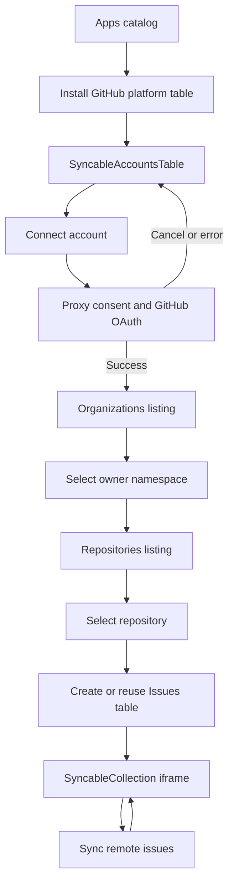

# Syncables Apps: wireframes and interactions

See [architectural decisions](builtin-syncables-apps.md). **These are conceptual wireframes**; the first implementation should reuse Atomic Server's existing Apps, TablePage, tabs, dialog and iframe-host patterns.

## 0. Apps / Discover integrations

```text
Apps                                      Search apps [____________]
Discover integrations · configured proxy: integrations.atomic.place

[GitHub icon]  GitHub             [Install]    (or [Open] if installed)
               Repositories, issues...
[Notion icon]  Notion             [Install]
[Calendar]     Google Calendar    [Install]

Drive apps (separate published / SRI-verified entries)
...
```

Installing a platform is not the same as connecting an OAuth account or selecting a remote collection. Clicking Install creates/reuses the platform table and opens it. A service from the proxy catalog does **not** include executable module JS. Do not show duplicate cards for the same user-visible provider without explaining the capabilities; avoid treating existing third-party apps as implicit replacements without review.

## 1. SyncableAccountsTable: platform table

```text
My Drive / GitHub
GitHub                                          [+ Connect account]
Accounts connected to this drive

Account         Connection                Action
michiel         ● Connected              [Browse organizations]
work-login      ↻ Reconnect required     [Reconnect]

[standard Table tab] [Accounts sync view]
```

*Before OAuth:* show an empty state with Connect account. The host navigates to the configured integration proxy, then provider OAuth, then returns to the same drive's platform table. Use existing signed PKCE handoff and recover cancellation. A platform table can exist without any connected accounts.

## 2. Account → Organizations table

```text
My Drive / GitHub / michiel / Organizations
Organizations available to this account                   [Refresh list]

Namespace      Kind                 Repositories   Open
ontola         Organization         2              [Open]
michiel        Personal namespace   1              [Open]
```

This is a **SyncableCollectionTypeTable**. An account grants access; it does not own organizations. The personal username is an owner namespace, not an actual GitHub Organization object. Use stable remote owner IDs (and owner kind) to reconcile links. Refreshing discovery does not mirror the child data tables.

## 3. Organization → Repositories table

```text
My Drive / GitHub / michiel / Organizations / ontola / Repositories
Repositories owned by ontola                               [Refresh list]

Repository          Owner      Issue mirror     Action
atomic-server       ontola     ● Active         [Open repository]
atomic-plugins      ontola     Not mirrored     [Open repository]
```

Also a **SyncableCollectionTypeTable**, but configured for the organization's repository collection and owner parameter. Each repository resource is born in its owning organization/namespace. Do not insert repositories directly beneath the connected-account row.

## 4. Repository → available child collections

```text
... / ontola / Repositories / atomic-server
atomic-server · Available collections

Collection      Mirror state       Action
Issues          Not mirrored       [Create and sync table]
Pull requests   Not mirrored       [Create and sync table]  (if supported)
```

On selecting Issues the trusted **host** checks for an existing canonical mirror of that source; if absent it creates an ordinary Atomic table with the SyncableCollection view and appropriate source binding. Idempotent retry must return the same table. Do not auto-sync every repository.

## 5. SyncableCollection: mirrored table

```text
... / atomic-server / Issues
atomic-server · Issues                  ● Synced
Mirror of GitHub issues in ontola/atomic-server

[↻ Sync now]  [Pause]  [Source details]
┌────────────────┐ ┌────────────────┐ ┌─────────────────┐
│ 42 records     │ │ 0 pending      │ │ Last successful │
└────────────────┘ └────────────────┘ └─────────────────┘

[Table] [Sync] (standard Table view remains available)

Issue       Title                      State
#2521       Built-in Syncables views   Open
...
```

Source details display the proxy origin, platform, connection reference, owner namespace, repository stable ID, collection definition, selected parameters and destination. Never show proxy tokens. Pause/resume is independent from moving or linking table resources.

## State transitions



## Demo script / testing personas

1. Open Apps and install GitHub. Confirm a **platform table** appears at drive root.
2. Click Connect account, continue through the simulated integration proxy and GitHub account chooser. Confirm no token shown/stored in the graph.
3. Browse Organizations. Verify `ontola` is an organization and `michiel` a personal owner namespace.
4. Open `ontola` → Repositories → `atomic-server` → Create and sync Issues.
5. Open the created mirror. Check Sync now, Pause/Resume and Source details; check the normal table tab.
6. Revisit a previously mirrored repo. It must offer **Open existing table**, not create a duplicate.
7. Move/link the mirror elsewhere; remote binding and reference from the discovery hierarchy must remain valid.

## Interaction and accessibility notes

- Real table semantics, keyboard-accessible row actions and menus, focus restored after OAuth return, and clear status text rather than icon/color alone.
- `Sync` is a stateful operation; do not make every ordinary row click implicitly start mirroring. Row click opens details; an explicit Create/Sync action starts the work.
- Distinguish **Refresh list** (discovery of organization/repository names) from **Sync now** (data mirror).
- Loading, permission denied, incomplete read, quota exceeded, reauthentication and offline states must remain explicit.
- Remote hierarchy is not the sole local navigation structure; moved or linked tables are supported by stable references.

## Clickable prototype

Standalone HTML demo: `github-sync-demo.html` (concept artifact from the design session). This uses *simulated data and OAuth*; it is not a functioning integration or a production iframe. It should be used as a UI discussion artifact, not as a test oracle for security behavior.
